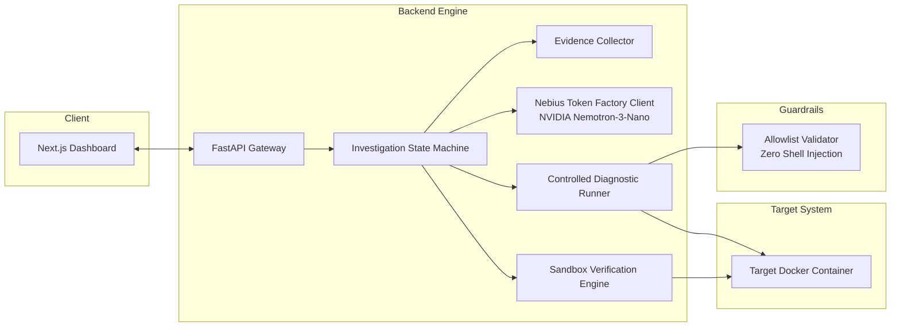

# FixLoop: Evidence-Driven Autonomous Debugging Agent

> **Nebius x NVIDIA Global AI Hackathon 2026**  
> **Track**: Coding and Agentic Engineering  
> **Model Integration**: Nebius Token Factory with `nvidia/NVIDIA-Nemotron-3-Nano-30B-A3B`

FixLoop investigates failures in Dockerized web applications, including cases where logs are incomplete, delayed, or misleading.

Unlike naive log summarizers or generic chatbots that guess solutions from static error snippets, FixLoop executes an **evidence-driven scientific cycle**:
1. Ingests raw container logs, Docker inspect metadata, and configurations.
2. Formulates competing root-cause hypotheses with confidence scores.
3. Dispatches controlled, safe diagnostic tests from a strict allowlist to eliminate false assumptions.
4. Gathers empirical evidence and refines diagnoses.
5. Generates a minimal unified diff patch only when confidence is high (>90%).
6. Verifies the fix in an isolated disposable sandbox.
7. Honestly reports verified success, failed fix, or insufficient evidence without hallucinating solutions.

---

## Architecture Overview



---

## Initial Supported Scenarios

| Scenario | Challenge | Initial Logs | FixLoop Diagnostic Probe | Expected Outcome |
|---|---|---|---|---|
| **Scenario 1: Healthcheck Misconfig** | App listens at `/healthz`; compose probes `/health` | Container repeatedly reported `unhealthy` | Probe `HTTP_GET /healthz` returns 200 OK, probing `/health` returns 404 | **VERIFIED_FIX**: Patches compose healthcheck path |
| **Scenario 2: Port Mismatch** | App listens on 8000; compose exposes 5000 | Host connection refused; app logs show listening | Probe `TCP_CONNECT 8000` succeeds, `5000` closed | **VERIFIED_FIX**: Patches compose port mapping |
| **Scenario 3: Missing Environment Variable** | App silently fails boot; crash logs omit missing var name | Generic crash: `Database initialization failed` | Probe inspects compose env vs config schema | **VERIFIED_FIX**: Patches missing `DATABASE_URL` |
| **Scenario 4: Ambiguous / Upstream Outage** | External third-party gateway unreachable | Network timeout to cloud service | Probe confirms local container config valid; upstream down | **INSUFFICIENT_EVIDENCE**: Honestly refuses to invent fix |

---

## Security Model & Threat Defense

- **Zero Host Shell Execution**: FixLoop never passes arbitrary shell commands from the LLM to the host shell.
- **Strict Allowlist**: Diagnostic probes are restricted to predefined types (`HTTP_GET`, `TCP_CONNECT`, `READ_TARGET_FILE`, `CHECK_ENV_KEY_EXISTS`, `INSPECT_CONTAINER_CONFIG`).
- **Injection Sanitization**: Targets and parameters containing shell metacharacters (`;&|`$<>`) are rejected immediately.
- **Path Traversal Protection**: File readers prohibit `..` and absolute paths outside the workspace.
- **Secret Hygiene**: API keys and credential strings are masked in logs, telemetry, and web responses.

---

## Quickstart & Environment Setup

### 1. Prerequisites
- Python 3.11+ (Tested on Python 3.13.1)
- Node.js 18+ & npm (Tested on Node v26.5.0 / npm 12.0.1)
- Docker & Docker Compose (Optional for Mock mode; required for live Docker verification)

### 2. Configure Environment
Copy `.env.example` to `.env`:
```powershell
cp .env.example .env
```
Edit `.env` and configure your Nebius credentials:
```ini
NEBIUS_API_KEY=your_actual_nebius_api_key_here
NEBIUS_BASE_URL=https://api.tokenfactory.nebius.com/v1/
NEBIUS_MODEL=nvidia/NVIDIA-Nemotron-3-Nano-30B-A3B
USE_MOCK_LLM=false
```
*(Note: If `NEBIUS_API_KEY` is not provided, FixLoop automatically operates in deterministic Mock mode for offline testing and evaluation).*

### 3. Install Backend Dependencies
```powershell
python -m venv .venv
.\.venv\Scripts\pip.exe install -r backend\requirements.txt
```

### 4. Run Unit & Security Test Suite
```powershell
.\.venv\Scripts\pytest.exe backend/tests/ -v
```

### 5. Start Backend Server
```powershell
.\.venv\Scripts\uvicorn.exe backend.app.main:app --host 127.0.0.1 --port 8000 --reload
```
API Documentation is available at: `http://localhost:8000/docs`

---

## Technical Documentation

- [Architecture Specification](docs/architecture_spec.md)
- [Implementation Milestones & Risk Register](docs/milestones.md)
- [REST API Contracts](docs/api_contracts.md)
