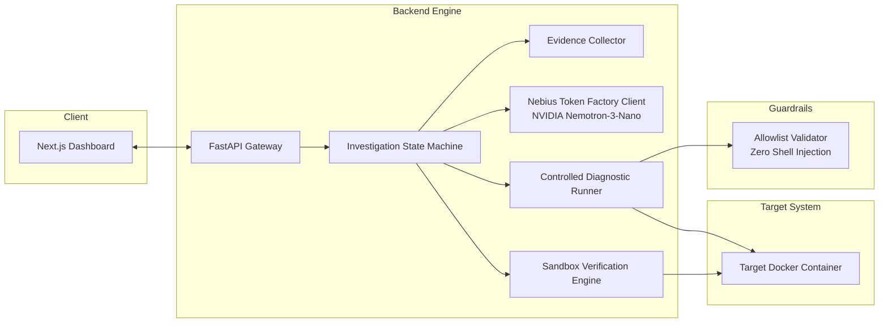

# FixLoop: Evidence-Driven Autonomous Debugging Agent

> **Nebius x NVIDIA Global AI Hackathon 2026**  
> **Track**: Coding and Agentic Engineering  
> **Model Integration**: Nebius Token Factory with `nvidia/NVIDIA-Nemotron-3-Nano-30B-A3B`

FixLoop investigates failures in Dockerized web applications, including cases where logs are incomplete, delayed, or misleading.

Unlike naive log summarizers or generic chatbots that guess solutions from static error snippets, FixLoop executes an **evidence-driven scientific cycle**:
1. Ingests raw container logs, Docker inspect metadata, and configurations.
2. Formulates competing root-cause hypotheses with confidence scores.
3. Dispatches controlled, safe diagnostic tests from a strict allowlist to eliminate false assumptions.
4. Gathers empirical evidence and refines diagnoses.
5. Generates a minimal unified diff patch only when confidence is high (>90%).
6. Verifies the fix in an isolated disposable sandbox.
7. Honestly reports verified success, failed fix, or insufficient evidence without hallucinating solutions.

---

## Architecture Overview



---

## Initial Supported Scenarios

| Scenario | Challenge | Initial Logs | FixLoop Diagnostic Probe | Expected Outcome |
|---|---|---|---|---|
| **Scenario 1: Healthcheck Misconfig** | App listens at `/healthz`; compose probes `/health` | Container repeatedly reported `unhealthy` | Probe `HTTP_GET /healthz` returns 200 OK, probing `/health` returns 404 | **VERIFIED_FIX**: Patches compose healthcheck path |
| **Scenario 2: Port Mismatch** | App listens on 8000; compose exposes 5000 | Host connection refused; app logs show listening | Probe `TCP_CONNECT 8000` succeeds, `5000` closed | **VERIFIED_FIX**: Patches compose port mapping |
| **Scenario 3: Missing Environment Variable** | App silently fails boot; crash logs omit missing var name | Generic crash: `Database initialization failed` | Probe inspects compose env vs config schema | **VERIFIED_FIX**: Patches missing `DATABASE_URL` |
| **Scenario 4: Ambiguous / Upstream Outage** | External third-party gateway unreachable | Network timeout to cloud service | Probe confirms local container config valid; upstream down | **INSUFFICIENT_EVIDENCE**: Honestly refuses to invent fix |

---

## Security Model & Threat Defense

- **Zero Host Shell Execution**: FixLoop never passes arbitrary shell commands from the LLM to the host shell.
- **Strict Allowlist**: Diagnostic probes are restricted to predefined types (`HTTP_GET`, `TCP_CONNECT`, `READ_TARGET_FILE`, `CHECK_ENV_KEY_EXISTS`, `INSPECT_CONTAINER_CONFIG`).
- **Injection Sanitization**: Targets and parameters containing shell metacharacters (`;&|`$<>`) are rejected immediately.
- **Path Traversal Protection**: File readers prohibit `..` and absolute paths outside the workspace.
- **Secret Hygiene**: API keys and credential strings are masked in logs, telemetry, and web responses.

---

## Quickstart & Environment Setup

### 1. Prerequisites
- Python 3.11+ (Tested on Python 3.13.1)
- Node.js 18+ & npm (Tested on Node v26.5.0 / npm 12.0.1)
- Docker & Docker Compose (Optional for Mock mode; required for live Docker verification)

### 2. Configure Environment
Copy `.env.example` to `.env`:
```powershell
cp .env.example .env
```
Edit `.env` and configure your Nebius credentials:
```ini
NEBIUS_API_KEY=your_actual_nebius_api_key_here
NEBIUS_BASE_URL=https://api.tokenfactory.nebius.com/v1/
NEBIUS_MODEL=nvidia/NVIDIA-Nemotron-3-Nano-30B-A3B
USE_MOCK_LLM=false
```
*(Note: If `NEBIUS_API_KEY` is not provided, FixLoop automatically operates in deterministic Mock mode for offline testing and evaluation).*

### 3. Install Backend Dependencies
```powershell
python -m venv .venv
.\.venv\Scripts\pip.exe install -r backend\requirements.txt
```

### 4. Run Unit & Security Test Suite
```powershell
.\.venv\Scripts\pytest.exe backend/tests/ -v
```

### 5. Start Backend Server (Local Development)
```powershell
.\.venv\Scripts\uvicorn.exe backend.app.main:app --host 127.0.0.1 --port 8000 --reload
```
- Health probe: `http://localhost:8000/health`
- Readiness probe: `http://localhost:8000/ready`
- Interactive OpenAPI Swagger UI: `http://localhost:8000/docs`
- ReDoc API Specification: `http://localhost:8000/redoc`

### 6. Install & Start Frontend (Next.js)

In a separate terminal:
```powershell
cd frontend
npm install

# For production build and run:
npm run build
npm start

# Or for local development hot-reload:
npm run dev
```
The FixLoop web application will be accessible at: `http://localhost:3000`

---

## Running with Docker Compose (Local & Production Demo)

FixLoop includes an isolated, secure multi-container Docker Compose configuration that runs both the backend and frontend without mounting the host Docker socket.

### 1. Build and Start All Services
```powershell
docker compose up --build -d
```

### 2. Verify Container Health
```powershell
docker compose ps
curl http://localhost:8000/health
curl http://localhost:8000/ready
```

### 3. Graceful Shutdown & Cleanup
To cleanly shut down and stop all containers:
```powershell
docker compose down
```
To remove volumes and orphaned containers during teardown:
```powershell
docker compose down -v --remove-orphans
```

### 4. Stopping Native Local Processes
When running natively in PowerShell:
- Press `Ctrl + C` in the respective PowerShell terminal windows running Uvicorn and Next.js.
- Or terminate from PowerShell:
  ```powershell
  Stop-Process -Name "uvicorn", "node" -Force -ErrorAction SilentlyContinue
  ```

---

## Safe Sample Project Investigation

A pre-packaged, safe sample project is available in [`sample_project/`](sample_project/README.md) demonstrating a real-world service crashloop caused by a missing environment variable.

### 1. Inspect the Sample Microservice
```powershell
Get-ChildItem -Path sample_project/
```
The folder contains a self-contained microservice (`Dockerfile`, `docker-compose.yml`, `main.py`, `logs.txt`, and `manifest.json`).

### 2. Investigate Safely via Web UI
1. Navigate to `http://localhost:3000`.
2. Select **Scenario A: Missing Environment Variable** in the scenario selector.
3. Click **Start Investigation**.
4. Observe the live state machine formulate hypotheses, verify ground truth facts, generate a minimal unified diff patch, and verify the fix in an isolated sandbox.

---

## Reproducible Evaluation Suite & Benchmark

FixLoop includes an automated, reproducible evaluation suite designed to measure whether the agent investigates failures effectively rather than merely generating plausible-sounding explanations.

### 1. Benchmark Scenarios (7 Scenarios)

The benchmark evaluates 7 deterministic scenarios across critical failure modes:
1. **Scenario A (Missing Environment Variable)**: Startup crash caused by missing `DATABASE_URL`. Supported root cause with verified fix.
2. **Scenario B (Healthcheck Endpoint Mismatch)**: Misleading clean startup logs, but container unhealthy. Probes distinguish `/healthz` vs `/health`.
3. **Scenario C (Port Forwarding Mismatch)**: Application listens on 8000, docker-compose forwards host 8000 to container 5000. Probe confirms port status.
4. **Scenario D (Insufficient Evidence / Upstream Outage)**: Upstream cloud payment service experiences network resets. Agent halts honestly at `insufficient_evidence` without hallucinating code fixes.
5. **Scenario E (Misleading Logs - Kernel OOM Exit 137)**: Logs report database connection pool timeout. Inspect reveals `OOMKilled: true` (exit code 137). Agent recognizes kernel memory exhaustion rather than database failure.
6. **Scenario F (Contradictory Evidence - Redis Error vs Disabled Config)**: Logs report Redis connection error, but compose config explicitly sets `REDIS_ENABLED=false` and uses in-memory cache. Agent detects contradiction, notes container is healthy, and avoids unnecessary patches.
7. **Scenario G (Regression in Patch - Sandboxed Verification)**: A patch introducing a syntax regression is tested. FixLoop sandboxed verification detects exit code 1, records `VERIFICATION_FAILED`, and reverts changes. Baseline falsely claims success.

### 2. Running the Benchmark (Single Command)

```powershell
.\.venv\Scripts\python.exe -m backend.app.eval.runner
```

To run the automated regression test via `pytest`:
```powershell
.\.venv\Scripts\pytest.exe backend/tests/test_evaluation_suite.py -v
```

### 3. Measured Empirical Results (FixLoop vs Log-Only Baseline)

The benchmark compares FixLoop directly against a **Log-Only Baseline** across the exact same scenarios and success criteria.

| Metric | FixLoop (Evidence-Driven) | Log-Only Baseline | Delta / Impact |
|---|---|---|---|
| **Root-Cause Accuracy Rate [MEASURED]** | **100.0%** (7/7) | **28.6%** (2/7) | **+71.4% improvement** |
| **Diagnostic Tests Required [MEASURED]** | **0.29 avg** | **0.0** | Targeted empirical probes |
| **Insufficient Evidence Accuracy [MEASURED]** | **100.0%** | **0.0%** | Zero hallucinations |
| **Clean Patch Application Rate [MEASURED]** | **42.9%** | **28.6%** | Minimal unified diffs |
| **Actual Verification Success Rate [MEASURED]** | **57.1%** | **14.3%** | Sandbox exit code ground truth |
| **False Claims of Successful Fixes [MEASURED]** | **0** | **4** | **100% elimination of false claims** |
| **Avg Investigation Duration [MEASURED]** | **89.4 ms** | **120.1 ms** | Fast deterministic fact-check |
| **Total Tokens Consumed [MEASURED]** | **3,623 tokens** | **1,833 tokens** | Bounded token footprint |
| **Estimated Inference Cost [ESTIMATE]** | **$0.001267** | **$0.000641** | ~$0.00018 per investigation |
| **Failures & Verification Retries [MEASURED]** | **1** | **0** | Caught regression & reverted |

*Note: Cost is an [ESTIMATE] computed using published Nebius Token Factory pricing for open-weights 70B models at $0.35 per 1M tokens ($0.00000035/token).*

### 4. Machine-Readable Outputs

The benchmark automatically saves full machine-readable results to:
- [`eval_results.json`](file:///e:/Hackathons/devpost/Nebius/eval_results.json): Structured JSON report with scenario summaries and metric breakdowns.
- [`eval_results.csv`](file:///e:/Hackathons/devpost/Nebius/eval_results.csv): Tabular CSV for spreadsheet analysis and CI ingestion.

### 5. Methodology & Limitations

- **Deterministic Fixtures**: All 7 scenarios use standardized file fixtures (`logs.txt`, `docker_inspect.json`, `docker-compose.yml`, `main.py`, `manifest.json`) to guarantee reproducibility.
- **Ground Truth Grounding**: Verification pass/fail is determined strictly by process exit codes (`exit_code == 0`) inside `DisposableSandbox`, not model self-attestation.
- **Limitations**:
  1. Benchmark fixtures simulate container runtime metadata; live network latency or non-deterministic OS kernels may vary probe execution times in production.
  2. Single-container microservice focus; multi-container distributed tracing across Kubernetes clusters is planned for future work.

---

## Technical Documentation

- [Architecture Specification & Risk Register](docs/architecture_spec.md)
- [REST API Contracts](docs/api_contracts.md)
- [Security & Reliability Audit Report](file:///C:/Users/atoz/.gemini/antigravity-ide/brain/6b9730cd-ade5-4a95-9e42-e3191010e904/audit_report.md)
- [Benchmark Results (JSON)](eval_results.json)
- [Benchmark Results (CSV)](eval_results.csv)
- [Official Hackathon Submission Package](docs/submission_materials.md)
- [Demo Video Script & Storyboard (< 3 min)](docs/demo_video_script.md)
- [Open Source License (Apache 2.0)](LICENSE)

---

## License & Open Source

FixLoop is open-source software licensed under the [Apache License, Version 2.0](LICENSE).
Copyright (c) 2026 FixLoop Hackathon Contributors.


