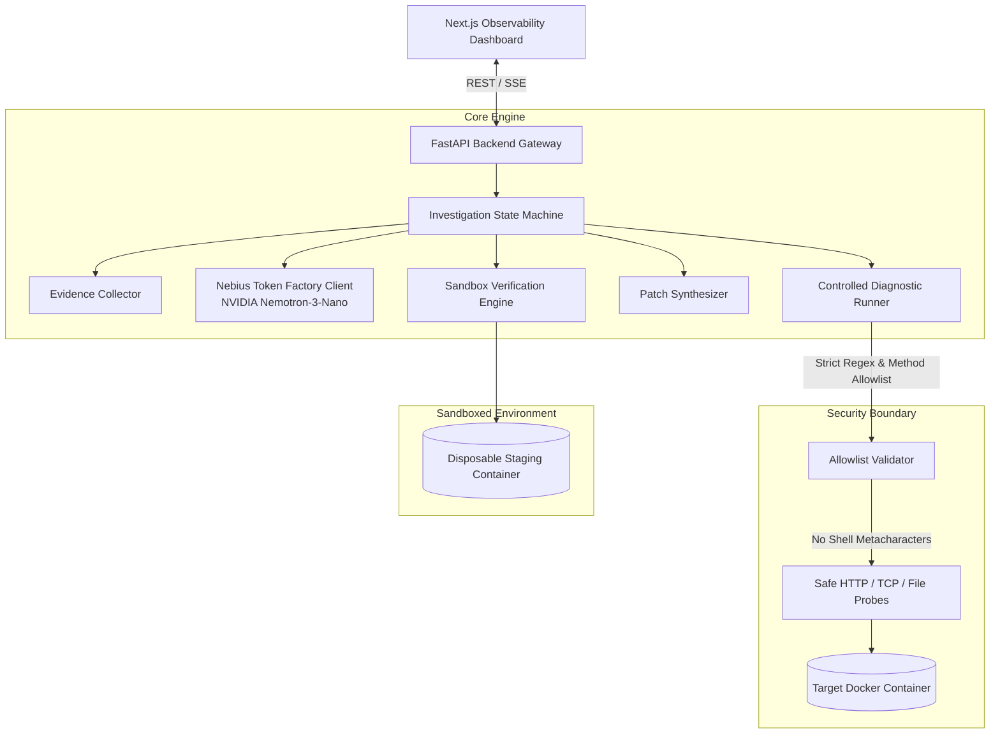

# FixLoop: System Architecture & Technical Specification

> **Target Track**: Coding and Agentic Engineering (Nebius x NVIDIA Global AI Hackathon 2026)  
> **Model Integration**: Nebius Token Factory with `nvidia/NVIDIA-Nemotron-3-Nano-30B-A3B`  
> **Status**: Architecture & Implementation Baseline (Phase 1)

---

## 1. Executive Summary & Core Value Proposition

Real-world failures in containerized applications are frequently accompanied by **incomplete, delayed, or outright deceptive logs**:
- An application logs `Server started successfully on port 8000`, yet the Docker health check marks it `unhealthy` because the check endpoint is `/health` instead of `/healthz`.
- A service crashes during startup with `Database initialization failed`, leaving developers guessing which specific environment variable was omitted.
- An upstream third-party service outage causes connection timeouts, which naive debugging chatbots attempt to "fix" by hallucinating invalid code modifications.

**FixLoop** is an **evidence-driven autonomous debugging engine**. Unlike generic chatbot wrappers or passive log summarizers, FixLoop treats logs and initial observations as **untrusted, partial clues**. It executes a scientific loop:
1. **Observe**: Ingest container logs, Docker inspection metadata, compose configuration, and source files.
2. **Hypothesize**: Formulate *competing* plausible root causes with confidence scores.
3. **Differentiate**: Select targeted, safe diagnostic probes from a strictly enforced **allowlist** to test hypotheses.
4. **Synthesize**: When evidence is conclusive (>90% confidence), produce a minimal unified diff patch.
5. **Verify**: Apply the patch in a sandboxed disposable environment and verify health status.
6. **Report Honestly**: If evidence remains insufficient or an external outage is diagnosed, honestly report `INSUFFICIENT_EVIDENCE` or request human intervention without inventing false fixes.

---

## 2. High-Level Architecture

---

## 3. Component Breakdown & Responsibilities

### 3.1 FastAPI Gateway & Routing (`backend/app/api/`)
- Exposes typed REST endpoints for health monitoring, scenario triggers, investigation state polling, and human approval gates.
- Performs input validation via Pydantic v2.
- Handles CORS, request logging, and structured error responses.

### 3.2 Evidence Collector (`backend/app/evidence/collector.py`)
- Ingests initial observations:
  - `docker logs` (stdout/stderr)
  - `docker inspect` (health status, restart counts, exit codes, port bindings)
  - `docker-compose.yml` and `Dockerfile`
  - Environment variable schema (masking secrets)
- Tags all evidence items with an immutable ID, timestamp, and source tag.

### 3.3 Diagnostic Allowlist & Runner (`backend/app/evidence/allowlist.py` & `diagnostic_runner.py`)
- **Strict Allowlist**: Prohibits arbitrary shell command execution. Permitted operations are limited to:
  - `HTTP_GET`: Test HTTP routes, response status codes, and payloads (e.g., `/healthz` vs `/health`).
  - `TCP_CONNECT`: Probe whether a target internal or external port is listening.
  - `READ_TARGET_FILE`: Read specific configuration or source files within workspace bounds (directory traversal prohibited).
  - `CHECK_ENV_KEY_EXISTS`: Verify presence of expected environment variable names without exposing values.
  - `INSPECT_CONTAINER_CONFIG`: Read safe inspection fields.
- **Human Approval Gate**: Any potentially state-altering action (e.g., container restarts or network reconnects) triggers an `AWAITING_HUMAN_APPROVAL` state.

### 3.4 LLM Reasoning Client (`backend/app/llm/client.py`)
- Communicates with **Nebius Token Factory** (`https://api.tokenfactory.nebius.com/v1/chat/completions`) using async HTTPX.
- Routes prompts to `nvidia/NVIDIA-Nemotron-3-Nano-30B-A3B`.
- Enforces strict Pydantic JSON schemas on model responses (`LLMHypothesisResponse`, `LLMPatchResponse`).
- Includes built-in `MockLLMProvider` for deterministic offline testing and CI workflows.

### 3.5 Autonomous Agent Loop (`backend/app/agent/loop.py`)
- State machine transitioning through:
  `INITIALIZING` -> `COLLECTING_INITIAL_EVIDENCE` -> `FORMULATING_HYPOTHESES` -> `EXECUTING_DIAGNOSTICS` -> `GENERATING_PATCH` -> `VERIFYING_PATCH` -> `COMPLETED`.
- Iteration bounded by `max_iterations` (default: 5).

### 3.6 Patch Synthesizer & Verification Engine (`backend/app/agent/patcher.py` & `verifier.py`)
- Generates unified diffs (`diff -u`) modifying only the root cause file (e.g. fixing port `5000` to `8000` in `docker-compose.yml`).
- Applies diff in a clean staging environment and executes verification tests.
- Only marks outcome as `VERIFIED_FIX` if verification commands exit 0 and health status becomes `healthy`.

---

## 4. Security & Threat Modeling

1. **Zero Host Shell Execution**:
   - The LLM is never provided an arbitrary `bash -c` execution tool.
   - All diagnostic probes are executed via dedicated Python socket/HTTP routines or parameter-checked CLI calls.
2. **Injection Defense**:
   - All targets and parameters are validated against `FORBIDDEN_SHELL_PATTERNS = re.compile(r"[;&|`$<>\\]")`.
   - File access is strictly constrained to workspace bounds; directory traversal (`..`) is unconditionally blocked.
3. **Secret Hygiene**:
   - `NEBIUS_API_KEY` is loaded as a `SecretStr` via `pydantic-settings`.
   - Keys are stripped from logs, telemetry, and frontend payloads.
   - Environment collectors mask all variable values matching `KEY`, `SECRET`, `TOKEN`, `PASSWORD`.

---

## 5. Technical Risk Register & Mitigations

| # | Technical Risk | Severity | Probability | Mitigation Strategy |
|---|---|---|---|---|
| **R1** | **Docker Daemon Unavailability on Host** | High | Medium | Dual-mode execution: live Docker mode when daemon is running, and accurate container simulator (`MockSandbox`) with identical filesystem, socket, and healthcheck contracts for testing/grading environments without Docker Desktop active. |
| **R2** | **Nebius Token Factory Rate Limits or Key Absence** | High | Low | Robust retry with exponential backoff in HTTPX client. Deterministic `MockLLMProvider` so evaluation can proceed offline without live cloud credentials. |
| **R3** | **LLM JSON Schema Deviations** | Medium | Medium | Low temperature (0.1) and strict system prompts. Resilient JSON extraction in `parser.py` that strips code fences and extracts raw JSON. Include fallback schema validation. |
| **R4** | **Host Command Injection from Untrusted LLM Output** | Critical | Low | Zero host command execution policy. All diagnostic actions match `DiagnosticAllowlist`. Any input containing shell metacharacters (`;&|`$<>`) is rejected immediately. |
| **R5** | **Infinite Reasoning Loops** | Medium | Low | Hard ceiling of `max_iterations = 5` per investigation. If confidence threshold is not reached within 5 iterations, state machine terminates with `INSUFFICIENT_EVIDENCE`. |

